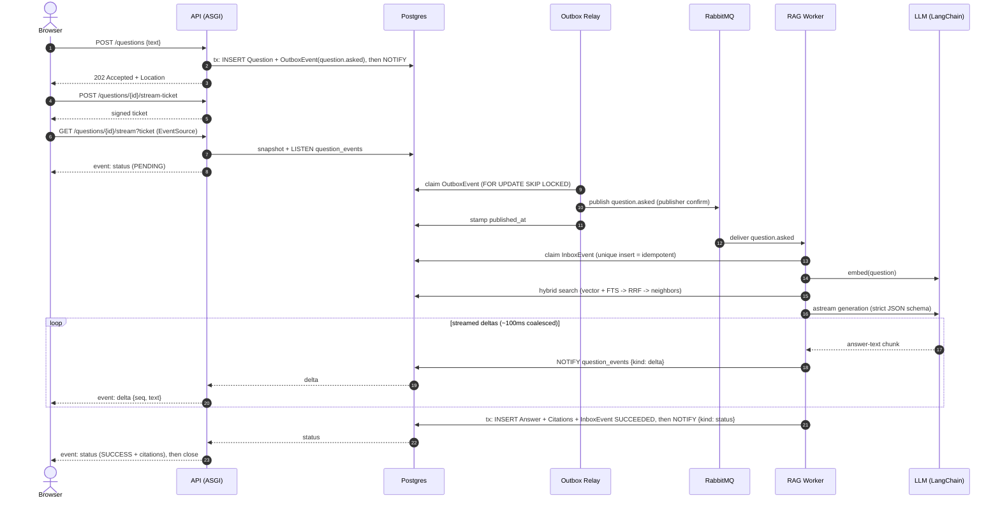
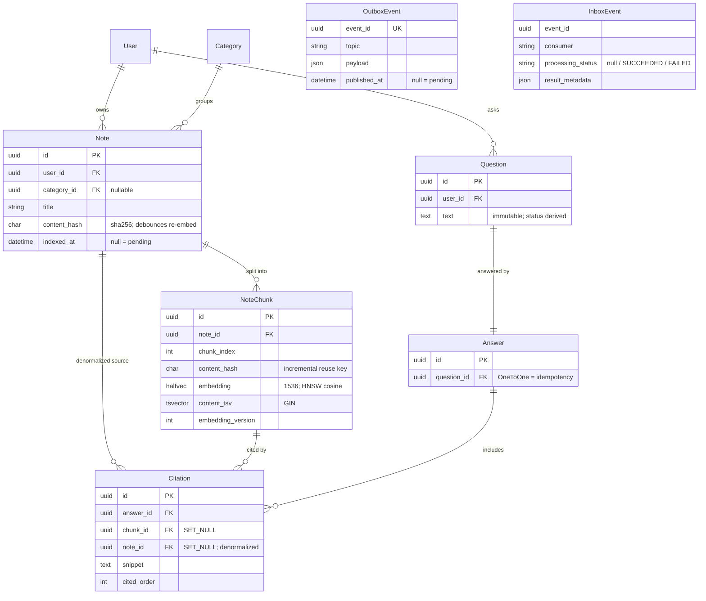

# Ask Your Notes: How it works

"Ask Your Notes" answers a natural-language question over **the user's own notes**
using retrieval-augmented generation (RAG). Questions are answered
**asynchronously** by an event-driven pipeline, the answer is **streamed back
token-by-token over SSE**, and every answer cites only the note chunks the model
actually used.

The whole system runs from `docker compose up`. Beyond the API, frontend and
Postgres, three small backend processes (same image, different command) move the
work:

| Process | Role |
|---|---|
| `backend` (uvicorn/ASGI) | REST API + SSE stream endpoint |
| `outbox-relay` | drains the transactional outbox `Postgres -> RabbitMQ` |
| `rag-worker` | consumes `question.asked`, runs the RAG pipeline |
| `embedding-worker` | consumes `note.embed.requested`, (re)indexes notes |

## Ask flow (sequence)

A question's status is never stored; it is **derived**: an `Answer` exists ->
`SUCCESS`; the rag-worker's `InboxEvent` is `FAILED` -> `FAILED`; otherwise
`PENDING`. Clients without SSE poll `GET /questions/{id}/` for the same view.

## Data model (ERD)

`OutboxEvent` and `InboxEvent` are the messaging ledgers. They carry **no FKs**
into the domain (correlation by id), so `Question`/`Answer` stay agnostic of the
transport, which is why status can be derived from the inbox without coupling.

## Architecture phases

The pipeline is five phases. Indexing (1) is a prerequisite that runs whenever a
note changes; the rest run per question.

### 1. Indexing
On note create/update, `RequestNoteIndexingUseCase` recomputes the note's
`content_hash` and emits `note.embed.requested` **only when the content changed**
(debounce). The `embedding-worker` splits the note into ~650-token chunks (15%
overlap), embeds **only new/changed chunks** (unchanged chunks reuse their stored
vector by hash: zero API cost), atomically swaps the chunk set, and stamps
`indexed_at`. A stale-event guard skips the work if a newer edit already queued.

**Storage and indexes.** Each chunk stores its embedding as `halfvec(1536)` with
two indexes, one per retrieval leg (phase 4): an **HNSW** index
(`halfvec_cosine_ops`) for vector/semantic search, and a **GIN** index on the
`tsvector` for full-text/lexical search. The dimension is `1536` because that is
the native output of `text-embedding-3-small`. The field is `halfvec` (float16),
not `vector` (float32): half-precision halves both on-disk storage and the in-RAM
HNSW index at negligible recall loss for L2-normalized embeddings.

### 2. Ask submission
`POST /questions/` writes the immutable `Question` and the `question.asked`
outbox event in a **single transaction**, then returns `202 Accepted`. No
processing state is stored on the question.

### 3. Event backbone
A **transactional outbox** guarantees the domain write and its event commit
together. The relay moves events `Postgres -> RabbitMQ` at-least-once (claim with
`FOR UPDATE SKIP LOCKED` -> publish with confirms -> stamp `published_at`).
Consumers are **idempotent**: each claims an `InboxEvent` via a unique insert, so
a duplicate delivery is acked and skipped; exhausted retries dead-letter to a DLQ
and mark the inbox `FAILED`. See [outbox-inbox.md](outbox-inbox.md) for the full
mechanics (sequence + lifecycle diagrams).

### 4. RAG generation
The `rag-worker` embeds the question, then runs **hybrid retrieval** in one SQL
statement: vector top-30 + full-text top-30 fused with Reciprocal Rank Fusion
(k=60) -> top-10 -> neighbor expansion (`chunk_index +/- 1`) -> dedup. The chunks go
to the LLM under a strict JSON schema (`CitedAnswer`); the answer and only the
**cited** chunks are persisted as `Answer` + `Citation`s in one transaction.
Empty retrieval short-circuits the LLM and returns a no-sources answer.

### 5. Streaming delivery
SSE authenticates via a short-lived **signed ticket** (`EventSource` can't send
auth headers). One **per-process broadcaster** holds a single `LISTEN
question_events` connection and fans Postgres `NOTIFY`s out to per-question
queues, so N concurrent clients cost one DB connection. The worker emits
ephemeral `delta` frames as it generates and a durable `status` frame at the end;
a 15s queue timeout falls back to a re-snapshot, so a dead broadcaster degrades
to polling instead of hanging.
