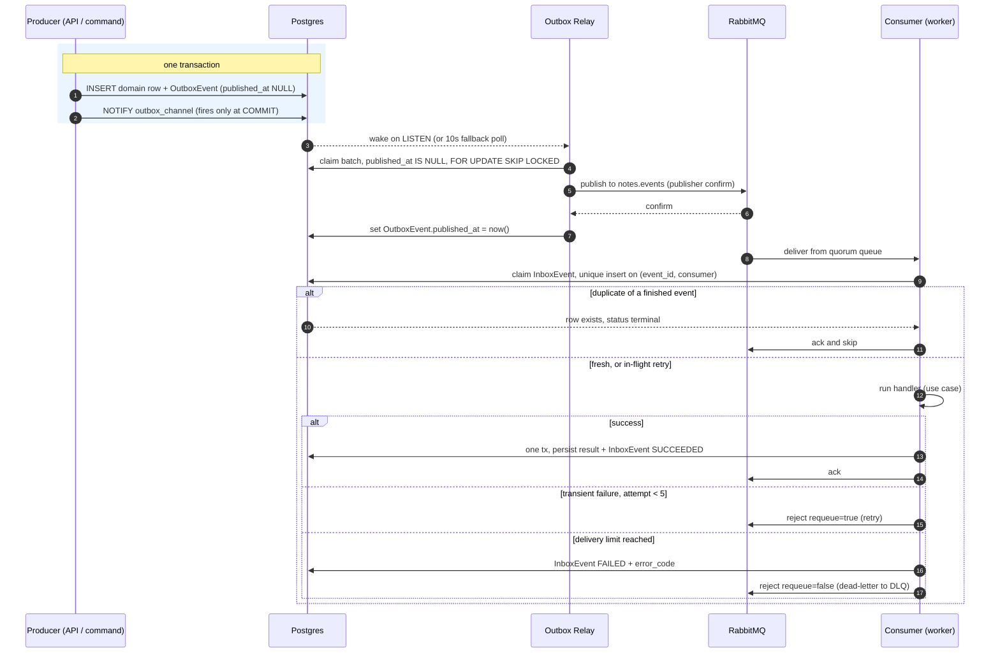
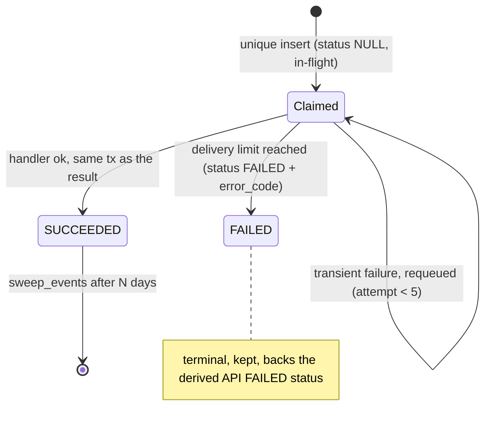
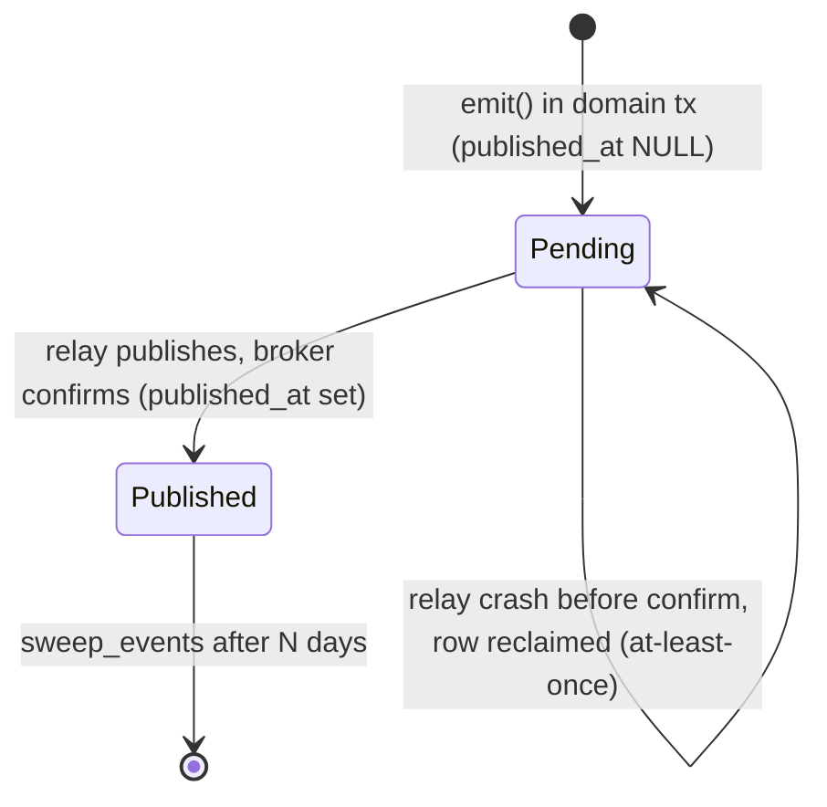

# The event backbone: transactional outbox + idempotent consumer

Ask-Your-Notes answers questions and indexes notes **asynchronously**: a domain write
(a new `Question`, an edited `Note`) must reliably trigger background work on a RabbitMQ
worker. The naive approach, "write the row, then publish to the broker", has a dual-write
hole:

- **commit the DB row, then crash before publishing** -> the work is silently lost (a question
  that never gets answered, with no trace);
- **publish, then fail to commit the row** -> a phantom event for a row that does not exist.

The fix is two ledgers in Postgres: an **outbox** on the publish side and an **inbox** on the
consume side. Together they turn unreliable "DB + broker" into **effectively-once** processing.

## End-to-end flow

## OutboxEvent (publish side)

**Write.** `DjangoEventOutbox.emit` (`infrastructure/messaging/outbox.py`) does two things inside
the **caller's** transaction (the request runs under `ATOMIC_REQUESTS`; commands open an explicit
tx): it INSERTs the `OutboxEvent`, and it issues `NOTIFY outbox_channel`. Postgres delivers a
NOTIFY only at **COMMIT**, so the domain row and its event commit or roll back together, and the
relay is never woken for work that was rolled back. There is no dual write.

**Publish.** A separate `run_outbox_relay` process (`relay.py`) is the only bridge to the broker:

1. It sleeps on `LISTEN outbox_channel` (zero queries while idle); the `NOTIFY` wakes it. Because
   NOTIFY is fire-and-forget, it also polls every ~10s as a durable fallback.
2. It claims a batch with `WHERE published_at IS NULL FOR UPDATE SKIP LOCKED` (over a partial
   index that is empty in steady state, so the poll is cheap). `SKIP LOCKED` lets multiple relays
   run without contending.
3. It publishes each event to the `notes.events` exchange with **publisher confirms** (it waits
   for the broker ack).
4. Only then does it stamp `published_at = now()`.

This is **at-least-once by construction**: crash anywhere between publish and stamp leaves the row
`published_at IS NULL`, so it is re-published. The worst case is a duplicate publish, which the
inbox absorbs.

| Field | Meaning |
|---|---|
| `event_id` | UUID, **unique**. The broker `message_id`; the inbox claims on it. |
| `topic` | Routing key, e.g. `question.asked`, `note.embed.requested`. |
| `correlation_id` | Domain aggregate id (e.g. `question.id`). No FK. |
| `payload` | Thin JSON envelope (ids + hashes), validated when it hydrates a domain entity. |
| `attempts` | Bumped on each relay claim, so a crashed publish leaves a trace. |
| `published_at` | `NULL` = pending; set = shipped. Partial index drives the relay poll. |

## InboxEvent (consume side)

`ConsumerRuntime._on_message` (`consumer.py`) handles each delivery:

1. **Envelope check.** No `message_id` or invalid JSON is *poison*: `reject(requeue=False)` sends
   it straight to the DLQ, never retried.
2. **Claim (idempotency).** `_claim` runs `InboxEvent.get_or_create(event_id, consumer)`. The
   unique constraint on `(event_id, consumer)` **is** the claim:
   - row created -> first time -> process it;
   - row exists with a terminal `processing_status` (`SUCCEEDED` / `FAILED`) -> duplicate of
     finished work -> **ack and skip**;
   - row exists with `processing_status = NULL` (in-flight) -> a **retry** after an earlier nack
     -> process it again.
3. **Handle.** Run the use case. On success the use case marks the `InboxEvent` `SUCCEEDED`
   **inside the same transaction** that persists the result (e.g. `asave_answer` writes
   `Answer` + `Citation`s + `SUCCEEDED` atomically), then the runtime acks the message.
4. **Fail.** Read `x-delivery-count`:
   - below `EVENTS_DELIVERY_LIMIT` (5) -> `reject(requeue=true)` -> retry;
   - at the limit -> mark `InboxEvent` `FAILED` with an `error_code`, then `reject(requeue=false)`
     -> dead-letter to the DLQ.

| Field | Meaning |
|---|---|
| `event_id` + `consumer` | **Unique together**; the pair is the idempotency claim. |
| `correlation_id` | Copied from the envelope; lets the API join status by aggregate. |
| `processing_status` | `NULL` in-flight, `SUCCEEDED`, or `FAILED`. |
| `error_code` | Machine-readable failure reason (e.g. `OPENAI_*`), set on `FAILED`. |
| `result_metadata` | LLM telemetry (model, tokens) for observability, not domain data. |

A redelivery of an already-finished event hits the unique row, sees a terminal status, and is
acked and skipped, no state change.

The outbox row has the simpler life:

## Two ledgers, on purpose

The publish side and the consume side are **separate** ledgers, not one "events" table:

- **Fan-out-safe.** The inbox key is `(event_id, consumer)`. If a topic ever gains a second
  consumer, each gets its own inbox row, its own claim, and its own status, independently.
- **Domain stays messaging-agnostic.** Neither ledger has an FK into the domain (correlation by
  id). `Question` / `Answer` carry no event ids, attempts, or error codes.

## Derived status and effectively-once

Because processing state lives on the ledgers, the API can **derive** a question's status instead
of storing it (`DjangoQuestionRepository.get_for_user`): an `Answer` exists -> `SUCCESS`; the
`rag-worker` `InboxEvent` for that question is `FAILED` -> `FAILED`; otherwise `PENDING`. That is
why retention (`sweep_events`) deletes published outbox rows and `SUCCEEDED` inbox rows but
**keeps `FAILED` ones**: they back the API's `FAILED` status.

The net guarantee is **effectively-once**:

- **at-least-once delivery** (outbox + relay never lose an event),
- **idempotent consumer** (the unique-insert claim drops duplicates),
- **structural backstop** (`Answer` has a `OneToOne` on `question`, so a double answer is
  impossible even if two deliveries race).

An event may be delivered many times; it takes effect exactly once.

## Topology and retention

`declare_topology` (`topology.py`) is declared idempotently by every process that touches the
broker, so boot order never matters:

- topic exchange **`notes.events`** + dead-letter exchange **`notes.events.dlx`**;
- **quorum** (Raft-replicated, durable) work queues:
  - `question.asked.q` (routing key `question.asked`) consumed by `rag-worker`;
  - `note.embed.q` (routing key `note.embed.requested`) consumed by `embedding-worker`;
- each work queue has `x-delivery-limit=5` and dead-letters to `question.asked.dlq` /
  `note.embed.dlq` via the DLX.

After an incident is fixed, `manage.py redrive_dlq --queue <dlq>` republishes parked messages;
poison messages (no valid envelope) are skipped. `manage.py sweep_events --days N` trims the
ledgers, keeping `FAILED` inbox rows.
